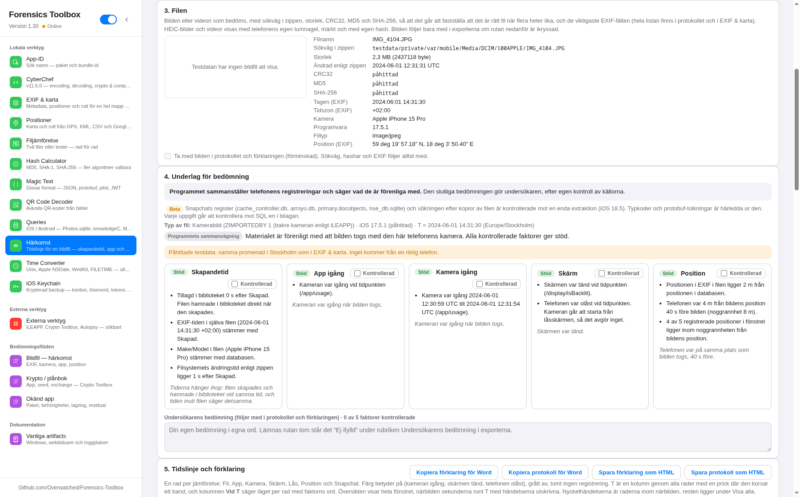
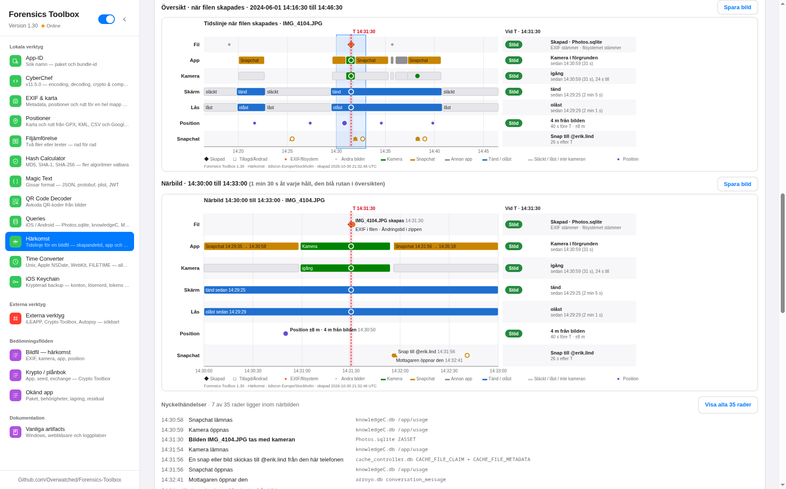
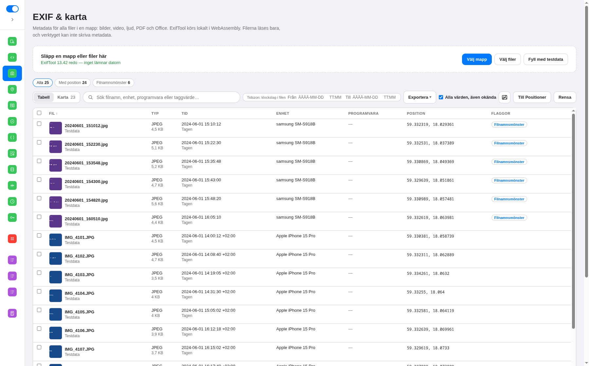
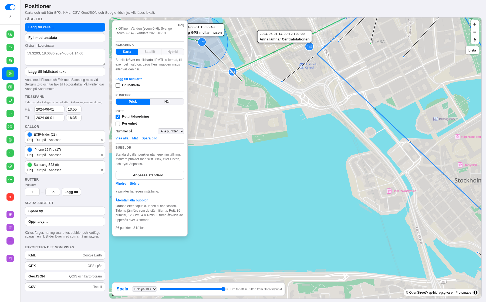

# Forensics Toolbox

Verktyg för IT-forensik som körs på din egen dator. Inget nätverk behövs. Onlinekartan är valfri och skickar bara kartrutor, aldrig filer eller bilder.

Öppna extraktionens zip-fil, så hittar appen databaserna själv. Zippen läses bara, inget packas upp, och `-wal` läses alltid med.



**Härkomst** (ny i 1.26, positioner i 1.27) bedömer om en bildfil är förenlig med att telefonen skapade den: skapandetid, app igång och kamera igång, var och en som stöd, motsägelse eller saknas.



Tidslinjen har en rad per jämförelse (Fil, App, Kamera, Skärm, Lås, Position, Snapchat): färg betyder på, grått av, och kolumnen Vid T säger läget per rad med faktorns ord. Översikten visar hela fönstret och närbilden sekunderna runt T med det viktiga för bedömningen utskrivet (resten blekt, eller allt med reglaget Det viktiga / Allt), följd av nyckelhändelserna med källa. Klicka på en källa för att se raderna i Queries, eller kopiera tabellen till Word. Filen som bedöms visas med sökväg, MD5, SHA-256 och de viktigaste EXIF-fälten, HEIC och video via telefonens egen tumnagel, och man kan söka på en tidpunkt när man inte vet filnamnet. Programmets sammanvägning är underlag: den slutliga bedömningen gör undersökaren, som skriver sin egen bedömning i en ruta som följer med i båda exporterna. Positionerna, bildens egen och telefonens från routined, visas i en tabell och på kartan med nålar, och avståndet mellan dem är en egen faktor. Båda exporterna kopieras rakt in i Word: förklaringen utan källor, för den som inte är tekniker, och protokollet med databas, sökväg, CRC32, SHA-256 och SQL för varje rad.



**EXIF & karta** läser metadata för en hel mapp med ExifTool, utan att filerna ändras. Positionerna går vidare till kartan.



**Positioner** ritar rutten på offlinekartan, med tidsspann, bubblor, tidsreglage och export till KML, GPX och GeoJSON.

## Ladda ner

[Senaste versionen](https://github.com/Overwatched/Forensics-Toolbox/releases/latest) är ungefär 1,5 GB, eftersom en offlinekarta följer med: hela världen i översikt och Sverige på gatunivå.

| Fil | Så använder du den |
|-----|--------------------|
| Windows-installer | Vanlig installation |
| `…-Portable.zip` | Packa upp och kör `Forensics Toolbox.exe` |
| Linux `.AppImage` | Gör filen körbar och starta den |
| macOS `.dmg` | Osignerad. Högerklicka och välj Öppna om datorn varnar |
| `…-html.zip` | När körbara filer inte är tillåtna. Öppna `Toolbox.html` och välj mappen `maps`. Ingen server behövs |

## Verktyg

- **EXIF & karta.** Metadata för en hel mapp, utan att filerna ändras. Positionerna ritas på en karta, med en rutt per enhet, tidsfilter och export till KML och GeoJSON.
- **Positioner.** Samma karta för GPX, KML, CSV, GeoJSON och Google-tidslinje.
- **App-ID.** Slå upp ett appnamn, eller klistra in ett paket-id och få namnet.
- **Queries.** Färdiga frågor mot Photos.sqlite, knowledgeC, routined Cache.sqlite, Android och Snapchat (beta), grupperade per operativsystem och app. Frågan kan köras direkt i appen, med `-wal` inläst, och positionerna kan visas i Positioner. Öppna extraktionens zip-fil, så hittar appen databaserna själv utan att något packas upp. Flera queries kan vara uppe samtidigt i varsin flik.
- **Härkomst.** Tidslinje för en bildfil: när den skapades, vilken app som var igång och om kameran var igång, ur Photos.sqlite, knowledgeC, routined och själva bildfilen i extraktionen. Typen avgörs först (kamerabild, skärmdump eller sparad ur en app), och varje faktor bedöms som stöd, motsägelse eller saknas. Tystnad i loggarna redovisas som saknas, aldrig som bevis. Filen visas med sökväg, storlek, CRC32, MD5, SHA-256 och EXIF i korthet (HEIC och video via telefonens egen tumnagel, märkt och med egen hash), bilden följer med i exporterna bara på begäran, och vet man tidpunkten men inte namnet söker man på tid och väljer ur en lista med tumnaglar. Två exporter för Word: ett protokoll med alla källor och hashar, och en förklaring i vanlig svenska. Nyckelhändelserna och händelserna med källa (databas → tabell → kolumn) kopieras också som egna tabeller för Word, och varje källa är en länk till Queries: samma SQL körs mot samma zip i en egen flik, med tiden i UTC bredvid råvärdet, så att undersökaren kan kontrollera raderna själv. *Beta:* filer utanför bildbiblioteket, till exempel i Snapchats cache, bedöms ur Snapchats egna register (vem som skickade, när den lästes, om Snapchats kamera spelade in), och **Var finns filen?** listar alla kopior av filen i extraktionen via storlek och CRC32. På Android (ny i 1.31) kommer app, skärm och lås ur `usagestats`, kameran per app ur `appops`, och Snapchats egna databaser läses, bland dem Memories som säger när en sparad snap togs och med vilken kamera, så att en bild Snapchat sparade till galleriet bedöms på tagningstiden, inte bara på när filen skrevs.
- **Övrigt.** Tidskonvertering, nyckelring, hash, filjämförelse, Magic Text, QR, CyberChef, korta checklistor och länkar till externa verktyg.

Kartan kan visa flygfoton eller satellitbilder (Satellit och Hybrid) om du lägger en bildkarta i `.pmtiles`-format i mappen `maps`. Inga bilder hämtas från nätet. Se [utvecklingsdokumentationen](docs/DEVELOPMENT.md).

Knappen **Fyll med testdata** i EXIF & karta, Positioner och Härkomst lägger in en påhittad promenad i Stockholm, så att kartan och tidslinjen går att prova direkt. Härkomst har dessutom **Testdata: Snapchat (beta)**: en video som spelas in med Snapchats kamera på samma promenad och bara finns i Snapchats cache, så att Snapchat-flödet, "Var finns filen?" och protokollet går att se utan extraktion. **Testdata: Snapchat på Android (beta)** visar Android-flödet: en selfie med Snapchats frontkamera sparad till galleriet, där T är `date_added`, tagningstiden kommer ur Memories, app, skärm och lås ur `usagestats` och kameran ur `appops`.

## Köra från källkod

Kräver Node.js 20.

```bash
npm install
npm start
```

Bygge, offlinekartan och hur ett verktyg läggs till beskrivs i [utvecklingsdokumentationen](docs/DEVELOPMENT.md).

## Upphov

Bygger på [CryptoToolbox](https://github.com/AdrianNeshad/CryptoToolbox) av Adrian Neshad. CyberChef kommer från [GCHQ](https://github.com/gchq/CyberChef). Kartdata © [OpenStreetMap](https://www.openstreetmap.org/copyright)-bidragsgivare (ODbL), via [Protomaps](https://protomaps.com). Onlinekartan kommer från [OpenFreeMap](https://openfreemap.org).
