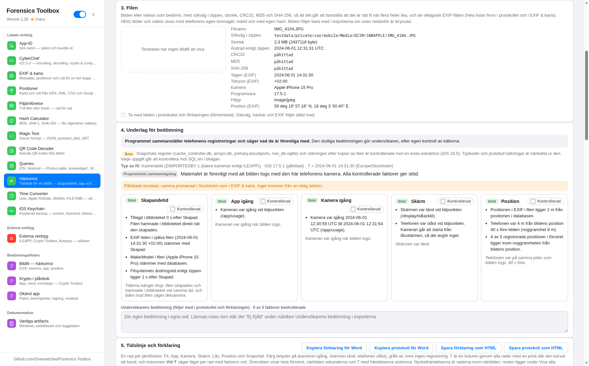
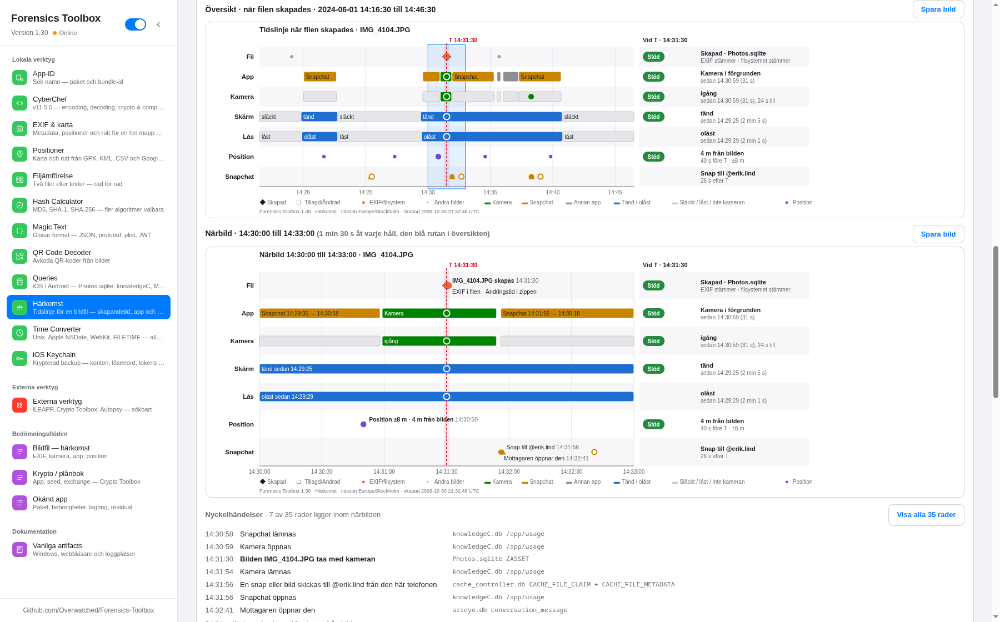
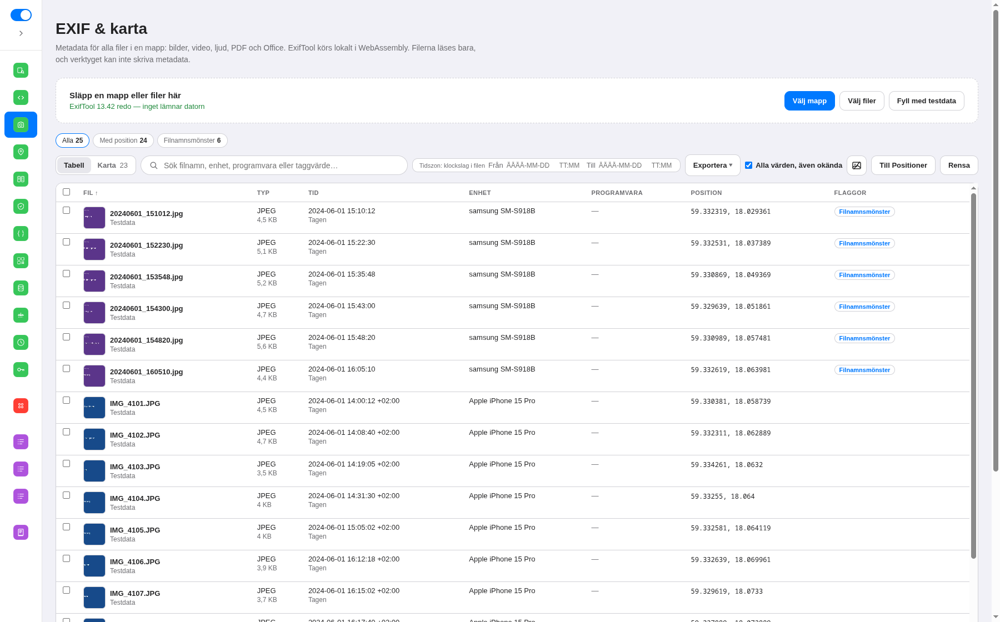
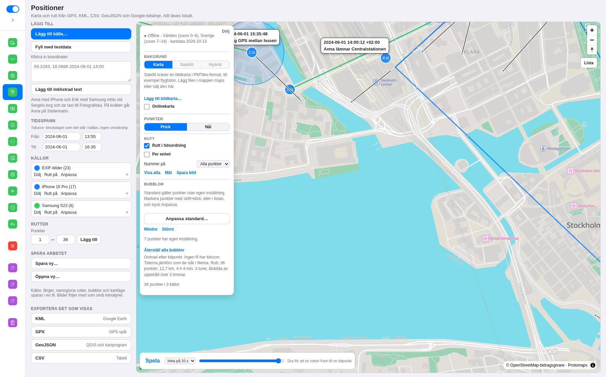

# Forensics Toolbox

Verktyg för IT-forensik som körs på din egen dator, utan nätverk (onlinekartan är valfri och skickar bara kartrutor). Öppna en extraktion (zip) eller en UFDR-rapport, så hittar appen databaserna själv. Inget packas upp eller ändras, och `-wal` läses alltid med.



## Verktyg

**Härkomst** bedömer om en bildfil är förenlig med att telefonen skapade den. Varje faktor (skapandetid, app igång, kamera igång, skärm, position) ställer en fråga och svarar i klartext: förenligt, inte förenligt eller går inte att bedöma. Tystnad i loggarna räknas aldrig som bevis, och den slutliga bedömningen gör undersökaren.

- Tidslinje runt filen, med källa (databas, tabell, kolumn) för varje rad och en länk till samma rad i Queries.
- Sök på filnamn, tidpunkt, hashsumma eller snap-id. Flera filer bedöms i en lista.
- Två exporter till Word: ett protokoll med källor och hashar, och en förklaring i vanlig svenska.
- Källor: Photos.sqlite, knowledgeC, Biome (appar och notiser), routined och PowerLog på iOS; MediaStore, usagestats (med notiserna) och appops på Android; SSRM och batterihistorik på Samsung. *Beta:* Snapchat (cache, chattar, Memories), Signal, WhatsApp och Telegram.



**Queries** har färdiga frågor mot iOS- och Android-databaserna ovan, och mot loggarna usagestats och Biome. Kör dem direkt mot extraktionen och se SQL:en och spårbarheten för varje resultat. Krypterade databaser (Signal, Snapchat på iOS) dekrypteras i minnet med nyckeln ur extraktionen.

**Chattar** *(beta)* visar konversationerna i WhatsApp, Signal, Telegram och Snapchat som i appen, med bilder och tider, och exporterar till HTML eller PDF.

**Laboration** hjälper dig göra en egen laboration: bygg ett flöde av steg, logga tiden för varje steg och läs sedan in loggen med extraktionerna för att se var varje steg syns i telefonen.



**EXIF & karta** läser metadata för en hel mapp med ExifTool och ritar positionerna på kartan.



**Positioner** ritar rutter från GPX, KML, CSV, GeoJSON och Google-tidslinje på offlinekartan, och exporterar dem.

**Övrigt:** App-ID, tidskonvertering, nyckelring, hash, filjämförelse, QR, CyberChef och checklistor.

Knappen **Fyll med testdata** visar hur verktygen fungerar utan extraktion.

## Ladda ner

[Senaste versionen](https://github.com/Overwatched/Forensics-Toolbox/releases/latest) är ungefär 1,5 GB, eftersom en offlinekarta följer med (världen i översikt, Sverige på gatunivå).

| Fil | Så använder du den |
|-----|--------------------|
| Windows-installer | Vanlig installation |
| `…-Portable.zip` | Packa upp och kör `Forensics Toolbox.exe` |
| `…-html.zip` | När körbara filer inte är tillåtna. Öppna `Toolbox.html` och välj mappen `maps` |
| `…-en-fil.html` | När Edge inte visar verktygen i html-versionen (låsta file://-länkar). Hela verktygslådan i en fil, utan CyberChef |
| Linux `.AppImage`, macOS `.dmg` | Byggs vid behov. macOS-appen är inte granskad av Apple: välj Öppna ändå under Systeminställningar > Integritet och säkerhet |

## Köra från källkod

Kräver Node.js 20.

```bash
npm install
npm start
```

Bygge, kartor och tester: [utvecklingsdokumentationen](docs/DEVELOPMENT.md).

## Upphov

Bygger på [CryptoToolbox](https://github.com/AdrianNeshad/CryptoToolbox) av Adrian Neshad. CyberChef kommer från [GCHQ](https://github.com/gchq/CyberChef). Kartdata © [OpenStreetMap](https://www.openstreetmap.org/copyright)-bidragsgivare (ODbL), via [Protomaps](https://protomaps.com). Onlinekartan kommer från [OpenFreeMap](https://openfreemap.org).
