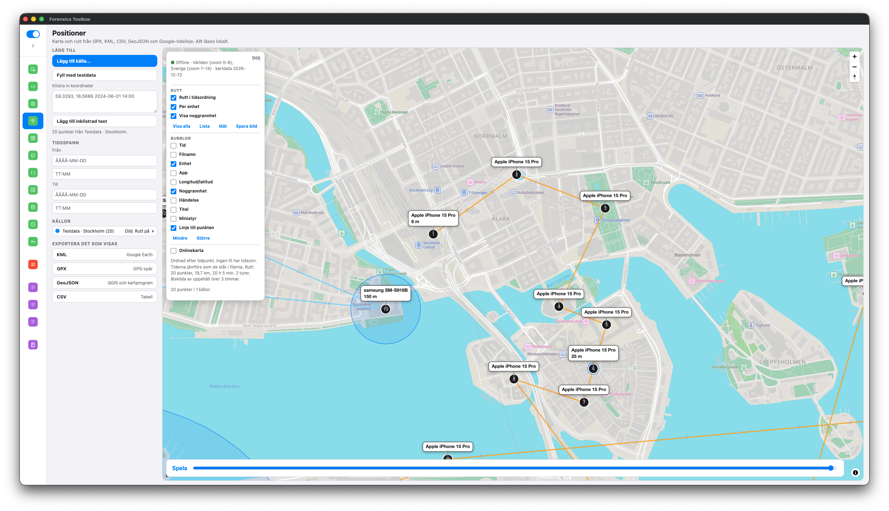
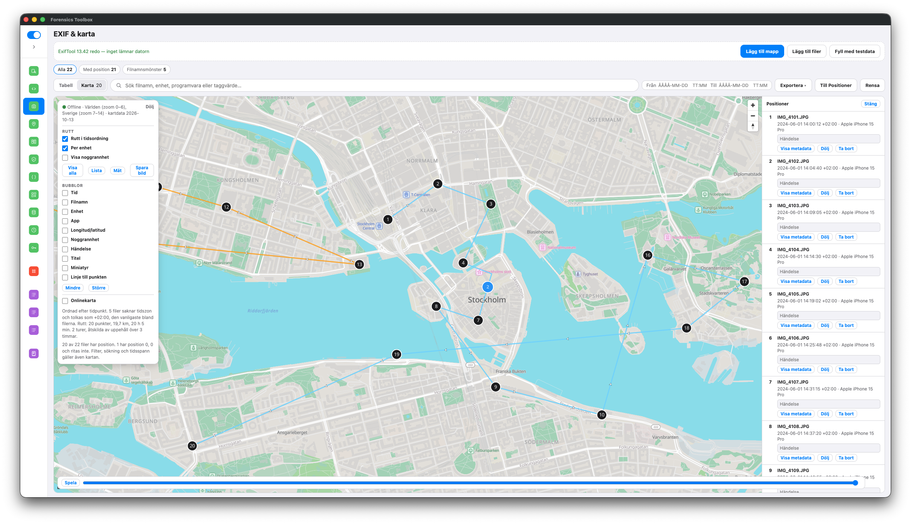
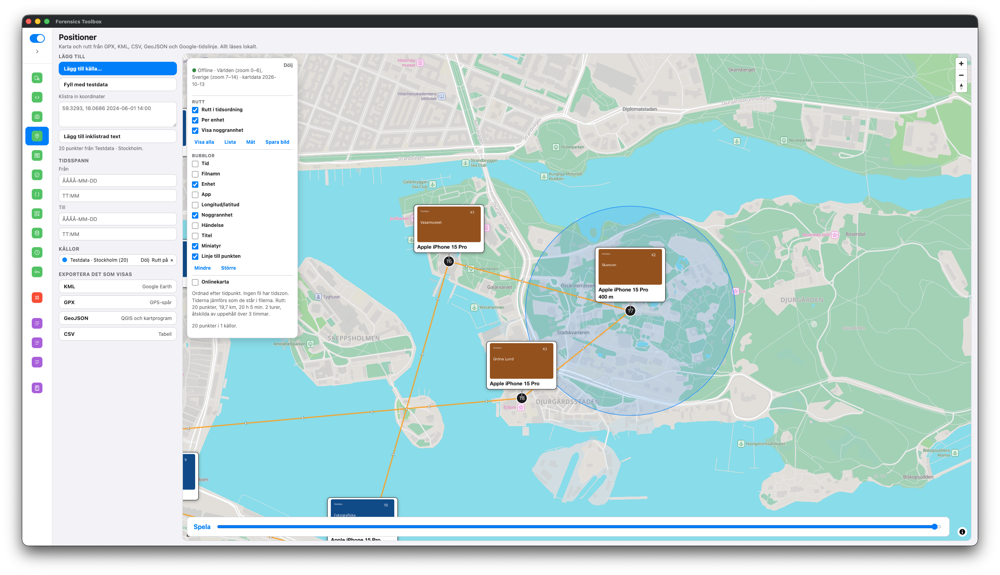

# Forensics Toolbox

Verktyg för IT-forensik som körs på din egen dator. Inget nätverk behövs. Onlinekartan är valfri och skickar bara kartrutor, aldrig filer eller bilder.







## Ladda ner

[Senaste versionen](https://github.com/Overwatched/Forensics-Toolbox/releases/latest) är ungefär 1,5 GB, eftersom en offlinekarta följer med: hela världen i översikt och Sverige på gatunivå.

| Fil | Så använder du den |
|-----|--------------------|
| Windows-installer | Vanlig installation |
| `…-Portable.zip` | Packa upp och kör `Forensics Toolbox.exe` |
| Linux `.AppImage` | Gör filen körbar och starta den |
| macOS `.dmg` | Osignerad. Högerklicka och välj Öppna om datorn varnar |
| `…-html.zip` | När körbara filer inte är tillåtna. Kartan följer med. `Öppna.bat` om skript får köras, annars öppna `Toolbox.html` och välj mappen `maps` |

## Verktyg

- **EXIF & karta.** Metadata för en hel mapp, utan att filerna ändras. Positionerna ritas på en karta, med en rutt per enhet, tidsfilter och export till KML och GeoJSON.
- **Positioner.** Samma karta för GPX, KML, CSV, GeoJSON och Google-tidslinje.
- **App-ID.** Slå upp ett appnamn, eller klistra in ett paket-id och få namnet.
- **Queries.** Färdiga frågor mot Photos.sqlite, knowledgeC och Android.
- **Övrigt.** Tidskonvertering, nyckelring, hash, filjämförelse, Magic Text, QR, CyberChef, korta checklistor och länkar till externa verktyg.

Knappen **Fyll med testdata** i EXIF & karta och Positioner lägger in en påhittad promenad i Stockholm, så att kartan går att prova direkt.

## Köra från källkod

Kräver Node.js 20.

```bash
npm install
npm start
```

Bygge, offlinekartan och hur ett verktyg läggs till beskrivs i [utvecklingsdokumentationen](docs/DEVELOPMENT.md).

## Upphov

Bygger på [CryptoToolbox](https://github.com/AdrianNeshad/CryptoToolbox) av Adrian Neshad. CyberChef kommer från [GCHQ](https://github.com/gchq/CyberChef). Kartdata © [OpenStreetMap](https://www.openstreetmap.org/copyright)-bidragsgivare (ODbL), via [Protomaps](https://protomaps.com). Onlinekartan kommer från [OpenFreeMap](https://openfreemap.org).
